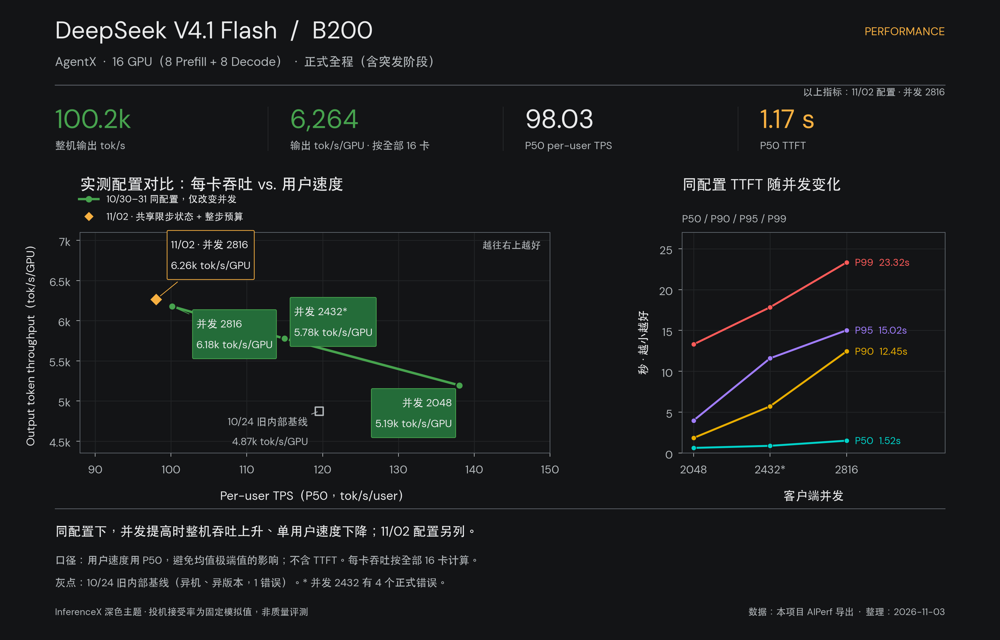

# DeepSeek V4.1 Flash B200 / B60 复现归档

本分支冻结 2026-11-02 的 B60（`pb-b60-1102a`）现有代码和参数，不修改原实现，不包含新跑分。

- **成绩**：16 张 B200（8P+8D）、C2816；全程 **100,225.93 tok/s**，稳态 **112,512.96 tok/s**；稳态 TTFT 均值/p90 **1.5545/2.5075 s**，ITL **10.7933 ms**，正式错误 **0**。
- **口径**：全程 usage completion tokens / 实际约 1840 s；稳态吞吐按 [600,1800) 完成请求，TTFT 按该窗口发起请求。B60 全程 TTFT 均值 3.163 s，突发段 11.555 s。
- **基座**：`94a29d316e8c1d6dcf6ff75645c2e61c7e3c83fd`；依赖版本和成绩见 [results.json](results.json)。
- **代码**：[P 的 45 个快照文件](overlays/prefill/vllm) + [D 的 38 个快照文件](overlays/decode/vllm)，来源和 SHA256 见 [source_manifest.json](source_manifest.json)。这是此前已核对的本地部署快照，本次未再次连接 GPU 节点。
- **范围**：仅完整保存 B60。B56 指标是参考，它使用 `ov-p84`，不能把这里的 P 快照当成 B56 的精确代码。

- **详细分位数**：[request_metrics.json](request_metrics.json) 保存 B56/B58/B57/B60 四组正式全程的 per-user TPS、TTFT、ITL 和请求总耗时，含 p1/p5/p10/p25/p50/p75/p90/p95/p99。全程包含突发阶段，与稳态口径分开。

## 性能图



主图按 [InferenceX](https://inferencex.semianalysis.com/inference) 的每卡吞吐—用户生成速度视角绘制；使用官方深色主题、NVIDIA 绿色、金色及分位数色板，来源见 [style_reference.json](figures/style_reference.json)。绿线连接同代码、同服务参数的 B56/B58/B57；B60 改过 P 调度，用金点单列。右图仅展示绿线三组的 TTFT。全部采用正式全程口径，包含突发阶段。Per-user TPS 不含 TTFT，与 InferenceX 默认端到端交互性口径不同。

横轴改用逐请求 TPS 的 **P50**，降低极端值对均值的影响；纵轴及点上标注为 tok/s/GPU，整机吞吐除以全部 16 卡。同配置 2048/2432/2816 的坐标为 (138.04, 5194.46)、(114.98, 5776.64)、(100.16, 6177.04)；B60 为 (98.03, 6264.12)。客户端并发是 AgentX lane/session 容量，不是同时 decode 的请求数，不能用整机吞吐除以它来计算单用户速度。

| 同配置并发 | 整机 tok/s | TPS 均值 | TPS P10 | TPS P50 | TPS P90 | TTFT P50（s） | TTFT P90（s） |
|---:|---:|---:|---:|---:|---:|---:|---:|
| 2048 | 83,111 | 147.14 | 118.44 | 138.04 | 194.26 | 0.637 | 1.854 |
| 2432 | 92,426 | 129.34 | 105.03 | 114.98 | 195.22 | 0.894 | 5.724 |
| 2816 | 98,833 | 114.84 | 89.38 | 100.16 | 178.47 | 1.523 | 12.447 |

TPS 的 P10 表示较慢端，P90 表示较快端。B58 有 4 个正式错误，其余三组为 0。逐请求 token 总数 / 实际约 1840 秒可复现整机吞吐，但 TPS 均值存在极端值，客户端也有事件循环停顿记录；紧凑导出缺少完整 SSE 时间戳，不能据此认定测量完全无偏。核查依据与限制见 [metrics_audit.json](metrics_audit.json)，本次没有新跑分。

[SVG](figures/performance_overview.svg) · [图表数据](figures/performance_data.json) · [绘图脚本](figures/plot_performance.py)。运行脚本需要 matplotlib 与中文字体，可用 `--font` 指定字体路径，`--latin-font` 可指定 InferenceX 使用的 DM Sans 字体。

## 与 10 月 24 日旧内部基线对比

均为 16 张 B200（8P+8D）、AgentX、1800 秒正式阶段，整机吞吐采用含收尾的约 1840 秒观察窗口。旧基线运行于另一组机器、使用 `df3bd094` 基座；后三组使用 `94a29d31` 基座。本表比较历史系统表现，包含代码、部署和负载并发的变化。

| 日期 / 配置 | 并发 | 整机 tok/s | 用户 TPS P10 / P50 | TTFT 均值 / P50 / P90 / P99（s） | 正式错误 |
|---|---:|---:|---:|---:|---:|
| 10/24 旧内部基线 | 2048 | 77,968 | 107.54 / 119.54 | 2.606 / 1.824 / 4.700 / 14.009 | 1 |
| 10/30 配置 | 2048 | 83,111 | 118.44 / 138.04 | 1.257 / 0.637 / 1.854 / 13.302 | 0 |
| 10/31 配置 | 2816 | 98,833 | 89.38 / 100.16 | 3.992 / 1.523 / 12.447 / 23.322 | 0 |
| 11/02 配置：共享限步状态 + 整步预算 | 2816 | 100,226 | 84.77 / 98.03 | 3.163 / 1.168 / 11.580 / 23.891 | 0 |

同为 C2048，10/30 相对旧内部基线吞吐高 **6.6%**，用户 TPS P50 高 **15.5%**。11/02 的最高吞吐比旧基线高 **28.5%**，其中同时增加了并发，不能算成调度单项收益。历史基线来源与统计方法见 [baseline_20261024.json](baseline_20261024.json)；旧记录只保留了用户 TPS P10/P50/P99 的精确审计值，未补造 P90/P95。灰点只作历史参考，不接入并发曲线。

## 11 月 2 日的 P 调度具体是什么

P 负责处理输入并产出交给 D 的 KV；D 负责后续生成。客户端并发仍是 2816。“新调度”只是 P 端配置变化，图表以日期标注。

1. **短任务优先（此前已启用）**：按扣除本地/外部缓存后还需补算的输入 token 数排序。例如 128K 输入命中 120K，只剩 8K，会排在 32K 全未命中的请求前。恢复中的请求优先；普通请求等满 10 秒后提权。这是提权阈值，不是 TTFT 的 10 秒上限。
2. **轻载限步的状态改为 DP 共享**：轻载时每 rank 每步最多 8192 token，单请求 chunk 最多 4096；任一 rank 排队超过 16 个请求就切到正常 16384 上限。全部 rank 排队不超过 10 且维持 1 秒，再切回轻载档。此前各 rank 读到的队列快照不同，可能一边限 8K、一边跑 16K；共享状态和滞回用于减少这种分歧。
3. **共享整步预算替换上下文预算**：用新 token 数和历史上下文估计整步计算时间；每个 rank 发布需求，明显更重的 rank 按其他 rank 已发布的最大需求裁短，余下 token 留到下一步。预算倍数 1.0，下限 32 ms、上限 1000 ms；通过本机共享内存读取近似需求，不新增阻塞式 all-reduce。原上下文预算只约束 attention 的一部分代价，11/02 已关闭。

**相对 10/31，新增的是第 2、3 项的变化，第 1 项并非刚加入。** 对应 [调度代码提交](https://github.com/Sy0307/vllm/commit/eb0e76832c31955a49bceb4fa3d54f212c55b7a2) 和 [实际参数](runtime/knobs/b60p.env)。

已有对照同时关闭上述三项 P 调度，其他优化保留：[600,1800) 窗口内 TTFT 均值 1.84 → 1.55 s、P90 3.28 → 2.51 s，但 P99 **6.12 → 11.05 s**。恢复期部分请求撞到 10 秒提权线，是明确的尾延迟代价；三项贡献尚未拆开，两次机器也不同，吞吐差不能归因于调度。该配置未达到原预注册聚合锁步效率门槛，仍是候选配置。

## 优化与对应提交

提交按归档文件主题分组；共享文件可能包含多个机制。表中提交是实测文件的归档入口，**不是独立消融或可逐项相加的性能补丁**。完整代码取分支最终版本。

| 优化 | 做了什么 | 已有证据与限制 | 归档 commit |
|---|---|---|---|
| P 调度 | 短任务优先（residual SJF）、动态 token 上限、DP 共享整步预算，缩短排队和过长的计算步。 | 与默认先来先服务、关闭这三项优化相比，平均首 token 等待从 1.84 秒降到 1.55 秒，90% 请求的等待从 3.28 秒降到 2.51 秒。三项一起测试，各自贡献尚不清楚。 | [eb0e76832](https://github.com/Sy0307/vllm/commit/eb0e76832c31955a49bceb4fa3d54f212c55b7a2) |
| KV 数据通路 | 输入线程 lookup prefetch、MultiConnector、early receive 通知线程、Mooncake load kick；把查找、加载及通知前移。 | 与关闭 load kick 相比，打开后平均首 token 等待降低约 6.3%，吞吐基本不变。 | [af39cf4ce](https://github.com/Sy0307/vllm/commit/af39cf4ce163bddec144c9b0345152b74185fec5) |
| Engram 主机行预取 | P 的 CPU offload 配合 8 线程行预取，与 GPU 执行重叠。 | 在单独开关行预取的端到端测试中，平均首 token 等待降低约 8.5%，输入处理耗时降低约 10.6%，吞吐提高约 0.33%。 | [a0af0237f](https://github.com/Sy0307/vllm/commit/a0af0237ff0e1c4b2ec007164c34f5aa7982b480) |
| D 分配与准入 | 跳过无操作 KV allocation、defer promote；配合 host core 中的 input gate。 | 在当前配置下，这一项能提升多少还没有单独测出。 | [b6892dc74](https://github.com/Sy0307/vllm/commit/b6892dc748b592d106eee7fbce81c15ceeeb0a2f) |
| 融合 draft sampling | 保留融合 kernel 与 NaN、边界修正，减少 draft 采样开销。 | 在当前配置下，这一项能提升多少还没有单独测出；固定模拟接受率也不能说明生成质量。 | [f29936ccc](https://github.com/Sy0307/vllm/commit/f29936cccce36c7ff931c02a4eb4697d33a5f56d) |
| MXFP8 预编译 | 提前编译可能使用的 GEMM tactic，避免服务中编译停顿。 | 已有运行时 compile stall 被消除的记录；没有独立吞吐结论。 | [597d66921](https://github.com/Sy0307/vllm/commit/597d6692195d1b831d0876dfe3aeb9dcde8cbadf) |
| 主机与模型基础优化 | compact int32 TokenIds、fast hash、每 16 步同步 GC、input gate，以及模型/runner 配套文件。 | 包含继承的 Canlin 基础优化与其他同期文件；未拆分单项收益。 | [f184ccabf](https://github.com/Sy0307/vllm/commit/f184ccabfe55305c4aa9577b08ada0542e2cc15b) |
| NIXL 断连恢复 | 失效 peer 清理、退避和重新握手，避免一次断连变成持续请求失败。 | 可靠性修正；网络根因未消除。 | [040885c57](https://github.com/Sy0307/vllm/commit/040885c570c0d5020dc950cda49260c6f5f837b0) |
| 部署参数 | frontend 放 D、绑核限线程、路由策略、B60 P/D knob。 | 性能取决于完整配置及外部依赖。 | [f8661ae9f](https://github.com/Sy0307/vllm/commit/f8661ae9f149519e8ac9c154c079887e3d45147e) |

公开 PR 来源：[#63932](https://github.com/vllm-project/vllm/pull/63932)、[#63933](https://github.com/vllm-project/vllm/pull/63933)、[#63934](https://github.com/vllm-project/vllm/pull/63934)、[#63936](https://github.com/vllm-project/vllm/pull/63936)、[#63938](https://github.com/vllm-project/vllm/pull/63938)、[#63940](https://github.com/vllm-project/vllm/pull/63940)、[#64500](https://github.com/vllm-project/vllm/pull/64500)。这些是开发来源；归档中还包括 PR 移植和本地修正，不能用 PR 当前 head 替代。

本地修正来源为 `4ac0ab768e12107a313aeedd3748fc81148e6c1f`（lookup 前截断 P prompt）与 `3c65a5dbafb04369ceb51503546d2943ccca8c31`（通知式 early receive）；相应实现已保存在本分支快照。最新上游已合入的 BF16 DeepSelect、compressed KV gather 复用、MegaMoE replica mapping、MegaAttn positions，不应继续算成相对当前 main 的私有优势。

### 仍保留的配置

| 项目 | B60 的实际值 / 作用 | 已有证据 |
|---|---|---|
| 缓存感知路由 | `pcache2`：前缀命中权重 1.0、prefill 负载权重 10、路由缓存估计 TTL 600 s | 路由策略仍启用；不可把实验过但未采用的 store-aware 路由算进来。[部署提交](https://github.com/Sy0307/vllm/commit/f8661ae9f149519e8ac9c154c079887e3d45147e) |
| D 流式输出合并 | `--stream-interval 8`，首 token 仍即时发出，后续减少输出事件 | 早期单轮端到端记录 +0.34%；不能外推为 B60 的独立收益。[参数](runtime/knobs/b60d.env) |
| D 控制同步节拍 | `--dp-sync-interval 256`，从默认 16 调整 | 只改变运行状态同步，不减少每层 MoE 通信；已有 D-only 记录未测出独立吞吐提升。[参数](runtime/knobs/b60d.env) |
| 基础执行配置 | 异步调度；P FULL_AND_PIECEWISE / D FULL_DECODE_ONLY；P/D 同步 EPLB，16 冗余专家，分别每 5000/12000 步 | 属于完整配方的基础条件，不作为新增私有算法收益。[启动文件](runtime/serve.sh) |

CPU 行还包括 `VLLM_PD_HOSTOPT=1` 的打包复用和仅解析需要的 KV group；lookup 前截断 prompt、dummy-run 时保留有效 connector 引用等正确性修正也继续保留。不能因为没有独立收益数字就作为冗余删除。

### 代码清理建议（尚未修改运行时代码）

1. **优先补通知线程的退出流程**：[early_kv_recv.py](overlays/prefill/vllm/v1/executor/early_kv_recv.py) 的通知循环没有停止条件，`close()` 只关闭 socket；[WorkerProc.shutdown](overlays/prefill/vllm/v1/executor/multiproc_executor.py) 随后还会销毁 worker/connector。并发完成通知可能与退出交错，应先停止通知、唤醒并等待线程退出，再关 socket。这是静态发现的退出风险，未复现运行故障。
2. **收拢实验开关与诊断**：B60 不启用 `_CtxBalance`、D 的 Engram peer-all、MegaMoE min-rows、replay padding 实验开关；仍有 wall-clock A/B toggle、逐步 JSONL、阶段计时和栈采样实现。后续工程分支可移出已放弃的实验、集中可选诊断，保留必要故障记录；归档保留原样。
3. **统一配置入口**：[serve.sh](runtime/serve.sh) 在删掉 `VLLM_PREFILL_STEP_COST` 后会自动补回 `ctx_budget_ms=40`，与 11/02 配方相反。预算模式应显式配置，避免用“未设环境变量”表达关闭；同时参数化节点、venv、模型和日志路径。
4. **减少 P/D 重复维护**：当前有 10 对内容完全相同的文件。后续集成应共享实现、保留确有差异的 P/D 行为；不要直接合并两份整文件快照或覆盖新上游改动。

SJF 的 10 秒提权线属于策略取舍，调整它会改变性能，不能当作纯代码清理。当前只做静态核查；实测快照、manifest 和性能结论保持不变。

## 使用方式

根目录 `vllm/` 保持冻结基座；归档在 `benchmarks/dsv41_b200_b60/`，不会因为 checkout 分支而自动生效。P、D 同名文件不同，应分别构造 overlay。

在已有匹配 vLLM wheel、原生扩展和依赖的 Linux 环境中，用该环境的 Python 执行：

```bash
VLLM_SITE=$($VENV/bin/python -c 'import importlib.util; print(importlib.util.find_spec("vllm").origin.rsplit("/", 1)[0])')
$VENV/bin/python benchmarks/dsv41_b200_b60/materialize_overlay.py \
  --role prefill --base-vllm "$VLLM_SITE" --output "$P_OVERLAY"
$VENV/bin/python benchmarks/dsv41_b200_b60/materialize_overlay.py \
  --role decode --base-vllm "$VLLM_SITE" --output "$D_OVERLAY"
```

`VENV` 是匹配基座的 venv；`P_OVERLAY`、`D_OVERLAY` 为尚不存在的目录。脚本复制归档文件，其余内容链接到已安装包，保留 `__init__.py` 和原生扩展。启动时将相应 overlay 加入 `PYTHONPATH` 最前面。

部署历史原件见 [runtime/](runtime/)：`serve.sh`、`pb.py`、`bench.sh`、路由策略及 B60 knob。它们保留原路径与日志开关，**不是通用的一键安装脚本**。换环境须设置基座/overlay/模型/Mooncake/Dynamo/harness 路径，复制 `nodes.env.example` 填写已分配的节点，并修改 run ID 和所有嵌入的日志路径；不要复用 `pb-b60-1102a`。远程登录和上传工具不在归档中。

关键参数：P 两个 DP4/EP4 实例、D 一个 DP8/EP8 实例，TP1；P seq/MBT=64/16384、D=256/2560；P 的 Engram CPU offload/8 线程，D GPU resident；Mooncake 为 8×80GB + 1192GB；P FULL_AND_PIECEWISE、D FULL_DECODE_ONLY。P/D 启动 MemAvailable 门槛为 1300/1200 GiB，冷启动曾约 36 分钟。

## 必须保留的限制

- 上述调度对照只关闭短任务优先、动态 token 上限和 DP 共享预算，其他优化保留，不能代表整套系统相对原版 vLLM 的收益。两次使用不同机器，约 1.5% 吞吐差与机器性能差接近，无法判断调度是否提高吞吐。
- 尾延迟有代价：包含突发恢复期时，默认调度让 99% 请求在 6.12 秒内收到首 token，当前优化需 11.05 秒；与 SJF 等待满 10 秒才提权有关。去掉恢复期后，两者 p99 为 5.43 / 5.72 秒，但当前优化的 p99.9 仍高约 38%。
- dspark k=5、synthetic AL=3.51、adaptive verification 关闭；这些成绩不证明真实接受率或输出质量。
- B60 未满足原预注册聚合锁步效率门槛，采用仍待定；C2048 尚未测试该配置。
- 保留源文件现状与哈希。本次只归档、检查打包一致性和发布链接，没有运行新性能、模型质量或功能测试，也未对快照自动格式化。
